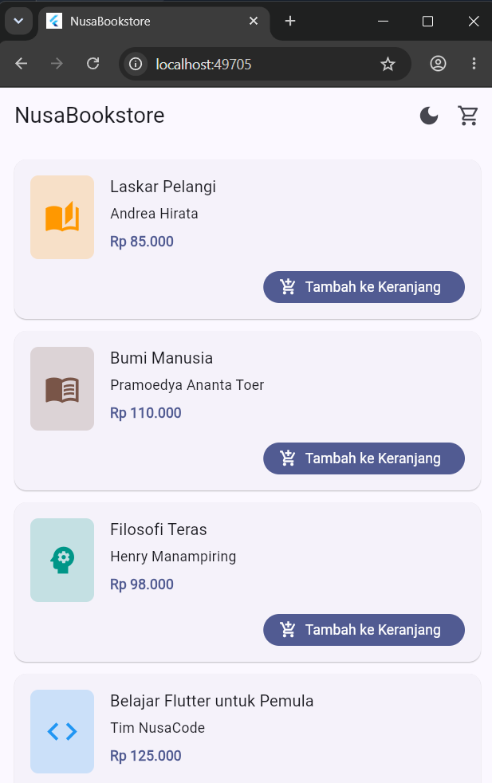
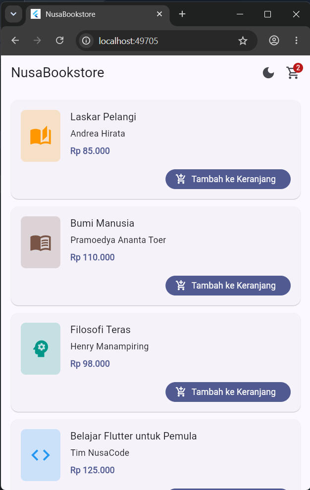
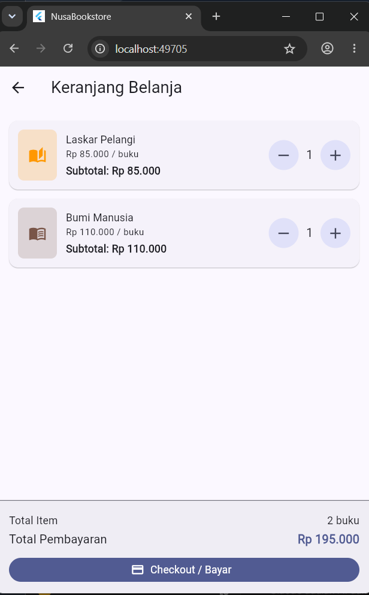
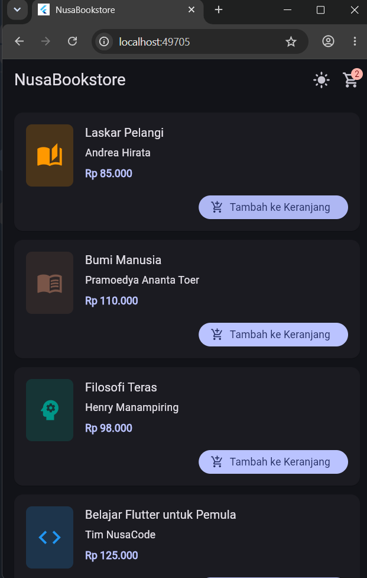
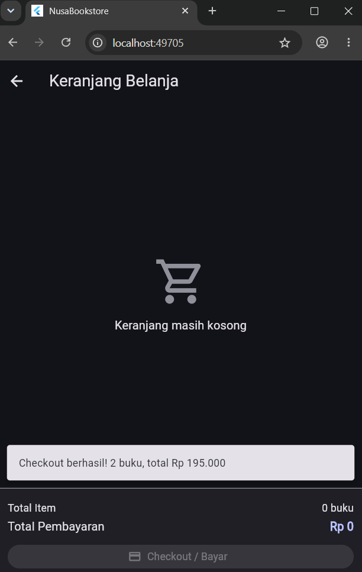

# NusaBookstore

Aplikasi toko buku sederhana (Flutter) dengan **State Management Provider**.

## Fitur
- Katalog 6 buku (`Card` + `ListView`) dengan tombol **Tambah ke Keranjang**
- Badge jumlah item pada ikon keranjang di `AppBar` (otomatis berubah)
- Halaman keranjang: tombol `-` / `+`, total item, total pembayaran (format Rupiah)
- Checkout: tampil `SnackBar` lalu keranjang dikosongkan
- Tombol **Light / Dark Mode** yang berlaku di seluruh aplikasi

## Konsep yang dipakai
`MaterialApp`, `Scaffold`, `AppBar`, `Card`, `ListView`, `Row`, `Column`,
`Consumer`, `context.watch`, `context.read`, `ChangeNotifier`, `MultiProvider`

## Struktur
```
lib/
├── main.dart                     # MultiProvider (CartProvider, ThemeProvider)
├── models/book.dart
├── providers/
│   ├── cart_provider.dart
│   └── theme_provider.dart
└── screens/
    ├── catalog_screen.dart
    └── cart_screen.dart
```

## Menjalankan
```bash
flutter create .      # sekali saja, untuk membuat folder android/ios/web
flutter pub get
flutter run
flutter test
```

## Screenshot

### Halaman Katalog


### Badge jumlah keranjang


### Halaman Keranjang (dengan total harga)


### Light Mode dan Dark Mode
| Light Mode | Dark Mode |
|---|---|
|  |  |

### SnackBar setelah checkout

